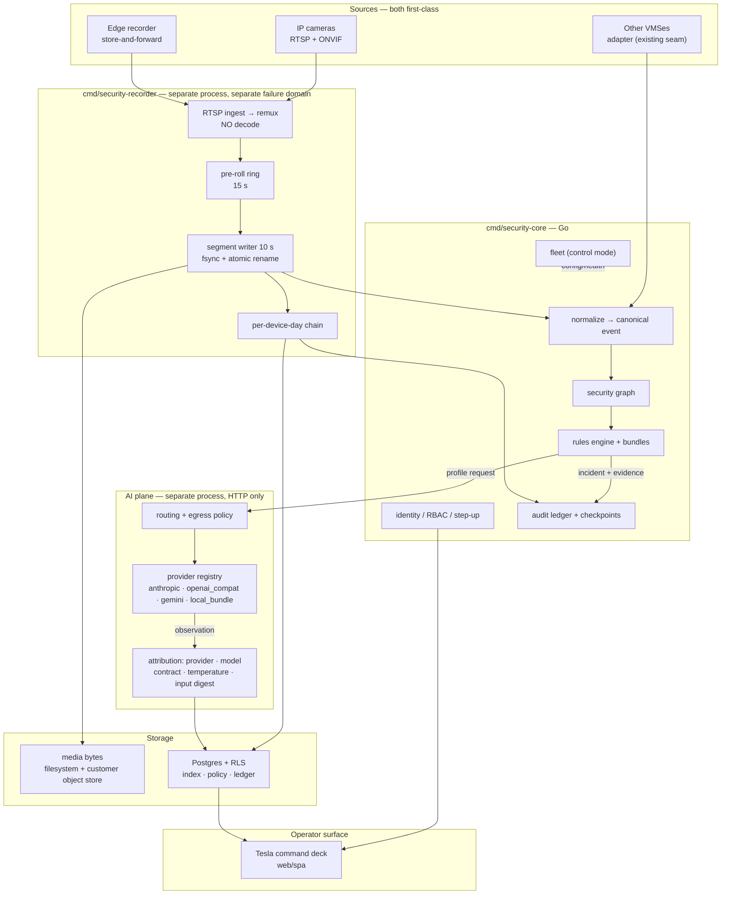

# M2 — AI VMS Execution Plan

Owner: E1. Status: living. Last revised 2026-10-21. Window: **2027-04-01 → 2027-09-30**.

Read [`../strategy-and-north-star.md`](../strategy-and-north-star.md) first — §1 is the
product, §7 is the feature test, §9 is the 2026-10-21 revision and its sign-off
state — and [`../master-roadmap.md`](../master-roadmap.md) §"M2" for the exit gate this
plan executes. `docs/status.md` is the authoritative build state and is not restated
here.

This is the plan the team executes. Every claim about what is built traces to
`docs/status.md` or to the code; every gate below is a command in
`scripts/verify.ps1` or a named test.

> **Unsigned.** `AGENTS.md` reserves the strategy change, every migration, every
> published contract change, the pricing model and the auth posture reversal to a
> human who reads the diff. §11 lists them. Nothing in this document is a decision
> until the signature block is filled in.

---

## 1. The product in one sentence

> **A VMS that proves.** Every frame, every decision and every exported evidence item
> is verifiable offline. Recording continues when the cloud, the network and the
> model are gone. The system states what it does **not** know. Video never leaves the
> site.

A VMS competes on the only axis available to a new entrant: **not recording video** —
everyone does — but **being able to prove what it recorded, what it decided, and what
it does not know**, while running the whole estate from a single calm operator
surface.

## 2. The ten locked decisions

| # | Decision | Why | Reopen trigger |
|---|---|---|---|
| **D1** | **Media: we own the camera path** (RTSP ingest, our recording) **and keep reading other VMSes** as a secondary source | Guarantees recording continuity, pre-roll and the hash chain on our own cameras; keeps the installed base and the OEM channel open | never |
| **D2** | **AI: policy-gated multi-provider. `local_only` is the default**; cloud is an explicit, audited, per-site opt-in | Keeps the regulated and air-gapped segment, and the repo's "no video to a cloud" posture, while giving the frontier-model quality the market expects | never |
| **D3** | **One language: Go for core and media. No Rust, no cgo in the recorder.** FFmpeg and ONNX only inside the AI sub-process | The record path is *remux, not decode* — I/O-bound, not CPU-bound. A second runtime means a second build, an FFI contract, a second release artefact and a second crash domain | Server-side decode at scale (H.265 web playback at high concurrency) → build a **bounded transcode pool**, do not rewrite in Rust |
| **D4** | **One binary, two modes: `site`** (devices, recording, evidence, AI) **and `control`** (fleet: sites, config, identity, health) | The roadmap's M5 without a rewrite; RLS already isolates tenant and site | multi-tenant SaaS as a distinct product |
| **D5** | **UI: evolve `web/spa`. No rewrite** | It already has one screen, one token file, one route table, a command palette and honesty gates | — |
| **D6** | **QA: extend the existing gate system. No new framework** | Forty-one gates, forty-five hand-run red-checks, a 100% mutation floor and a fourteen-category QA matrix are the strongest net in this industry. Adopting a new framework is a regression | — |
| **D7** | **The media plane is a separate binary: `cmd/security-recorder`** | Mirrors the existing `security-migrate` reasoning — the recorder must not be able to reshape the schema under the core — and gives recording its own failure domain | — |
| **D8** | **No server-side decode on the record path.** The camera and the browser decode | 100 devices at 4 Mbps ≈ $30 of CPU, not $800. This is what makes "no gaps" affordable | — |
| **D9** | **Video never leaves the site. Only management may federate to cloud** | The incumbents do camera-to-cloud; this is the one position they cannot copy without contradicting their own story, and it is what the regulated segment buys | — |
| **D10** | **Postgres + RLS is the system of record. Media bytes live on the filesystem or the customer's own object store** | SQL lives in migrations; video never enters the database; RLS is the tenant boundary | — |

## 3. Scope boundaries — the non-goals

- Not a cloud video service. We host no video, ever.
- Not a camera manufacturer. We consume cameras; we do not build them.
- Not a general SIEM. Physical security is the whole product.
- Not a foundation-model shop. We use other people's models behind our own abstraction; the abstraction is the asset.
- Not a device-driver plugin marketplace in the first cut. The Adapter SDK starts with VMS sources, analytics and integrations.
- Not a GPU farm for playback. One bounded transcode pool, nothing more.
- **We do not rip and replace a customer's working VMS where our adapter already reads it.** Both sources are first-class.

## 4. The fifteen root fixes

Every row names where the fix lives in this repository and **which gate proves it**.
A control with no failing test is a comment.

| # | Industry problem | Root fix | Code home | Gate that proves it |
|---|---|---|---|---|
| 1 | Vendor AI is a black box — "the model missed it" is unprovable | Every AI output is a stored, attributed, replayable observation; the deterministic core runs with the AI plane entirely absent | `internal/observations`, `internal/incidents/replay.go` | `ai-attribution`, `ai-shadow-gate` |
| 2 | "The model wasn't there" is logged as "the model said no" | Three absences kept distinct — `no observation` / `degraded` / `insufficient_evidence` — each degradation carrying a **named reason** | `internal/aistate`, `observations.Degradations` | `ai-degradation-distinct` |
| 3 | Evidence is a pile of screenshots and exports that cannot be re-derived | Content-addressed evidence store, hash-chained append-only ledger, signed sealed checkpoints, decisions replayed from stored facts | `internal/evidence`, `internal/audit`, `internal/checkpoint` | `recording-chain`, `audit verify-seals` |
| 4 | No vendor-neutral way to audit a multi-vendor estate | One canonical event model and one ledger covering every source, including other vendors' | `internal/normalize`, `internal/graph` | `audit-coverage` |
| 5 | The camera is the weakest link: default credentials, no isolation, silent compromise | Per-device credential vault (the secret is never in the database), mTLS service identity, device isolation, signed OTA with rollback, and a camera state machine that knows `blind` | `internal/device`, `internal/identity` keystore, `internal/camerahealth` | `credential-redaction`, `device-isolation`, `ota-signature` |
| 6 | Buyers cannot compare recording continuity between VMSs | `recording_continuity_gap_seconds` as a first-class measured metric, plus a per-device-day hash chain so the recording itself is provable | `internal/recording` | `media-continuity` |
| 7 | Cloud VMS is unusable in regulated and air-gapped sites | Local-first; signed offline release archives; no licence server; no video egress | `internal/lifecycle`, `internal/release` | `airgap-install` |
| 8 | A lapsed licence stops the customer's security | A perpetual, non-expiring licence that **never gates operation**; only support entitlement lapses, visibly | `pricing-and-packaging.md` §6 option E | `licence-never-blocks` |
| 9 | Integrators are locked into one vendor's ecosystem | Open published contracts, Adapter SDK, a public certification suite, a no-fork OEM clause, attribution never white-labelled | `contracts/`, `internal/contracts` | `contractcheck`, `sdk-conformance` |
| 10 | Video walls are 1990s GUIs | The Tesla command deck: one screen, AI pre-triage, one-key disposition, no navigation in the operator loop | `web/spa` | `console_honesty`, `e2e/command-deck`, `a11y` |
| 11 | False alarms burn out a desk, and the vendor never says how many | Per-site base rate, calibrated scoring, the North Star and its four companions — computed **at the customer's site**, from their own labels | `internal/calibration`, `internal/threat`, `internal/operatormetrics` | `metrics-report` schema, `predicate-cov` |
| 12 | Vendors never publish their own limitations | `NOT RUN` is a distinct verdict everywhere, and the product ships a capability report of what is unevidenced | `internal/statuscheck`, `securityctl acceptance` | `acceptance-verdicts` |
| 13 | Search is per-vendor and per-tenant | One canonical record, one search across every source, natural-language investigation that resolves every hit to an incident or an evidence row | `internal/eventsearch`, `internal/investigate` | `nl-hits-resolve`, `nl-replays-without-model` |
| 14 | Device clocks drift, so cross-camera correlation is quietly wrong | Drift measured per device, `normalized_at` as the only time a window predicate may read, drifted sources **excluded from corroboration** | `internal/clock`, `internal/clocksub` | `drift-exclusion` |
| 15 | A provider, model or prompt change silently alters behaviour | Every change to model, prompt, profile or **provider** forces re-evaluation plus a shadow run; the ledger names the provider, the model, the contract version and the temperature | `internal/evaluation`, `internal/airuntime` | `ai-regression-shadow` |

## 5. Target architecture



### 5.1 Process boundaries — each one is a control, not a preference

1. **The recorder is a separate binary and a separate process.** It owns no schema
   change and cannot write the audit ledger. It writes segments and index rows; the
   core seals and audits them. A recorder crash must not stop event ingest, and an
   ingest crash must not stop recording.
2. **The AI plane is a separate process reached over HTTP** — already true, and
   enforced by a dependency rule. A hung inference cannot hold a lease.
3. **The deterministic core never imports the AI plane** — already true. A rule that
   consumes a Tier-C signal must declare `if_ai_unavailable`.
4. **The core never imports the recorder.** Recording is upstream of the core, not
   inside it.

### 5.2 The record path, specified

| Aspect | Decision |
|---|---|
| Ingest | RTSP over TCP-interleaved (UDP as fallback). No decode, no transcode. |
| Remux | Annex-B H.264/H.265 → **fragmented MP4**, so a segment is independently playable and the browser decodes it with hardware acceleration. `internal/mp4` already parses Annex-B — extend it, do not rewrite it. |
| Segment length | 10 s default, configurable 5–30 s. |
| Write | tmp file → `fsync` → atomic rename. A partially written segment is recorded as `state='partial'` with its true boundary. **A partial segment is never a silent hole.** |
| Pre-roll | 15 s rolling ring per device (memory + spill file) so a clip contains its cause. `internal/mp4.PreRoll` already implements this. |
| Index | One Postgres row per segment, **partitioned by day**, written in the same transaction as the file's state change — the `outbox` discipline. |
| Chain | `chain[n] = SHA256(chain[n-1] ‖ segment_digest ‖ started_at)` per `(site, device, day)`. The chain head is **sealed into the audit ledger** at day close — one ledger row per device-day, not per segment. At 100 devices × 10 s that is 864 000 segments/day; a ledger row each would be a self-inflicted denial of service. |
| Retention | Policy per site and device. A job deletes and writes **one** ledger row per deleted range. Legal hold blocks deletion. |
| Health | bitrate, fps, frame drops, latency, plus the existing `fresh / stale / silent / blind` camera vocabulary, plus `recording_continuity_gap_seconds`. |
| Storage tiers | hot: local NVMe · warm: the **customer's** S3-compatible object store · cold: archive. Video never enters Postgres. |
| Playback | fMP4 over HTTP → browser MSE/WebCodecs. H.265 is unsupported by most browsers → a **bounded, GPU-backed transcode pool** is the one place transcoding is allowed. |
| Live tiles | The camera's own snapshot/MJPEG via ONVIF. **Zero server CPU** for a video wall. |
| Live stream | RTSP/WebRTC egress for the one focused camera only. |

## 6. Data model and contracts

### 6.1 New tables — forward-only migrations, expand and contract ship separately

| Table | Key columns |
|---|---|
| `devices` | `site_id`, `kind`, `make`, `model`, `firmware`, `onvif_device_id`, `rtsp_ref`, `credential_ref`, `capabilities` (jsonb, **measured**), `substream_profile`, `enabled` |
| `device_credentials` | `device_id`, `secret_ref` → the keystore. **The secret is never in this table.** |
| `recording_segments` | `site_id`, `device_id`, `seq`, `started_at`, `ended_at`, `bytes`, `digest`, `codec`, `width`, `height`, `fps`, `storage_ref`, `state`, `chain_prev`, `chain_hash` — partitioned by day |
| `recording_chains` | `site_id`, `device_id`, `day`, `chain_head`, `sealed_at`, `seal_ref` |
| `recording_policies` | `site_id`, `device_id` (nullable = site-wide), `continuous`, `pre_roll_s`, `post_roll_s`, `segment_s`, `retention_days`, `legal_hold` |
| `recording_exports` | `site_id`, `package_ref`, `manifest_digest`, `chain_slice`, `requested_by`, `created_at` |
| `ai_policies` | `site_id`, `mode` (`local_only` / `cloud_allowed` / `pinned_model`), `providers` (jsonb), `redaction_profile`, `pinned_model`, `egress_allowed` |
| `ai_egress_log` | `site_id`, `provider`, `model`, `profile`, `input_digest`, `bytes_sent`, `redacted`, `request_id`, `at` — append-only, audited |
| `sites` | `site_id`, `name`, `timezone`, `tenant_id`, `region`, `status` |

> `sites.default_locale` **does not exist** — it was dropped by migration
> `0010_drop_default_locale.expand.sql`. Do not re-add it. A site gets its locale
> from its profile at render time.

### 6.2 New and changed contracts

- New protos: `recording.proto` (Segment, RecordingChain, RecordingPolicy),
  `export.proto` (ExportPackage, ExportManifest), `aipolicy.proto` (AIRoutingPolicy,
  ProviderSpec, EgressPolicy).
- Extended: `camera.proto` (`rtsp_url`, `credential_ref`, `capabilities`,
  `substream_profile`, `onvif_device_id`), `device.proto`.
- New OpenAPI paths: `/v1/devices`, `/v1/devices/{id}/capabilities`, `/v1/recordings`,
  `/v1/recordings/timeline`, `/v1/recordings/gaps`, `/v1/exports`, `/v1/ai/policy`,
  `/v1/ai/providers`, `/v1/health/media`.
- New JSON Schemas: `capability-manifest.schema.json`, `ai-egress-record.schema.json`.
- **Apply** the already-written `docs/proposals/hosted-model-attribution.md`
  (migration 0022) and extend it with `provider_id` and `input_digest`.

## 7. The AI plane — provider registry, routing, egress

`deploy/ai-runtime/runtime.py` today loads exactly one signed local bundle.
Multi-provider is a **new contract surface**, not a configuration change.

### 7.1 Providers

| Adapter | Covers | Transport |
|---|---|---|
| `local_bundle` | the existing signed ONNX/bundle path | in-process |
| `openai_compatible` | OpenAI, Ollama, vLLM, LM Studio, LiteLLM, Azure OpenAI | plain HTTP, OpenAI chat/completions shape |
| `anthropic` | Claude | plain HTTP, Messages API shape |
| `gemini` | Gemini | plain HTTP, `generateContent` shape |

**No new Python dependencies.** The runtime is a dependency-free process by design —
risk D-04: "a runtime that pip-installs at start is a runtime an air-gapped site cannot
run". Each provider is a hand-written plain-HTTP adapter. One adapter for the whole
OpenAI-compatible family covers Ollama and every self-hosted stack, which is the
cheapest correct answer.

### 7.2 Routing and egress

- The request carries the site's `AIRoutingPolicy`. The runtime selects the provider.
- A provider failure produces a **named** degradation; the rule's `if_ai_unavailable`
  path runs; the incident is still raised deterministically. **A provider outage never
  becomes a dropped incident.**
- Every answer records `provider_id`, `model_identity`, `model_contract_version`,
  `temperature`, `input_hash`, and **`input_digest` — the hash of exactly what left
  the site** (a redacted frame's hash; a metadata record's hash). A local answer
  records the same fields with the bundle digest.
- `local_only` (the default) forbids all outbound traffic. `cloud_allowed` permits
  only the listed providers and only **redacted** frames and metadata.
  `pinned_model` pins provider, model and version.
- **Frame redaction before egress**: person, plate, face-crop and credential regions
  never leave. `internal/embedaudit` is extended from the embedding surfaces to the
  egress record, so the prohibition becomes structural rather than a convention.
- The policy and every egress are audited acts in the hash-chained ledger.
- **Provider parity**: the same question to two providers produces two observations,
  both attributed, neither overwriting the other. `internal/evaluation` scores **per
  provider**, so the choice of provider for a site is measured rather than assumed.

## 8. The work plan

Phases are ordered by dependency. Phases marked **⟂** can run concurrently with the
previous one. Every phase ends in a gate; **a phase with a red gate is not done.**

| Phase | Goal | Deliverables | Exit gate |
|---|---|---|---|
| **P0** ⟂ | **Strategy and contract baseline** (human-signed) | Amend `strategy-and-north-star.md` §1/§7, `master-roadmap.md`, `risk-register.md`, `pricing-and-packaging.md` §1.1/§4. This document. Update `internal/statuscheck` and `internal/roadmapcheck` to derive the new numbers — **they fail until the documents are right; that is the point** | `statuscheck`, `roadmapcheck` green |
| **P1** ⟂ | **Device registry + ONVIF** | `internal/device`, `internal/onvif` — WS-Discovery, device info, profiles S/T/G/M/A/C/D, PTZ, snapshot, imaging, analytics events. Credential references into the existing keystore. **The capability manifest is measured per device, never assumed** — the same discipline as `internal/milestone`'s `Unverified` flag, and a claim without a probe result is not a capability | `device-capability-manifest`, `credential-redaction` |
| **P2** | **The media plane** | `cmd/security-recorder`, `internal/recorder` — ingest, remux, pre-roll, segment writer, health, atomic writes, partial-segment recording | `media-continuity`, `pre-roll`, `disk-full`, kill-9 at the segment-write stage, `recorder-schema-isolated` |
| **P3** | **Index, retention, playback, export** | `internal/recording`, `internal/export` — per-day partitioning, the per-device-day chain, retention enforcement, timeline queries, playback assembly, ONVIF Export File Format plus a signed manifest | `recording-chain`, `retention`, `export-fidelity` |
| **P4** ⟂ | **The AI plane** | `deploy/ai-runtime/providers/*`, `internal/aipolicy`, migration 0022 plus `provider_id`/`input_digest`, egress redaction | `ai-egress-policy`, `ai-attribution`, `provider-parity`, `ai-regression-shadow` |
| **P5** | **Intelligence integration** | Camera analytics (ONVIF Profile M) → canonical events → rules → VLM verification → incidents → dispositions → evidence. `internal/calibration` learns per-site base rates from real dispositions. The existing canonical event vocabulary becomes the AI plane's input contract | `securityctl acceptance` extended; **zero `NOT RUN`** |
| **P6** ⟂ | **The Tesla command deck** | `web/spa` evolution — see §9 | `console_honesty`, `e2e/command-deck`, `a11y`, `e2e/honesty`, `e2e/refusals`, `spa` |
| **P7** | **Fleet / control plane** | `internal/fleet`, `cmd/security-core` control mode — multi-site, config distribution, health aggregation, upgrade orchestration, OIDC/SCIM. The control plane is pulled mid-incident and recording continues | `fleet-config-drift`, `oidc-scim`, `control-plane-failover` |
| **P8** ⟂ | **The edge appliance** | `cmd/security-recorder` edge profile — store-and-forward, later reconciliation with no duplicates, fully air-gap installable | `edge-store-forward`, `edge-reconcile-no-duplicates`, `airgap-install` |
| **P9** | **Ecosystem, certification, commercial** | Adapter SDK v1 (VMS sources, analytics, integrations, workflows), a public certification suite, a marketplace, vertical packs as rule packs and never as a fork. ONVIF membership with their conformance tool run in CI — **"certified", not "compatible"** | `sdk-conformance`, `contractcheck` across all surfaces, `no-fork` enforcement |

### 8.1 Parallelism and the critical path

- **P0, P1, P4 and P6 are independent of each other** and start immediately.
- **P2 → P3 is the hard sequence**: the recorder must exist before the index can be
  trusted.
- **P5 depends on P2** (there must be something recorded to verify) and on **P4**.
- **P7 depends on P1 and P3. P8 depends on P2. P9 depends on P3 and P5.**
- **The true critical path is not code.** Camera-lab procurement, design-partner
  contracts, the SOC 2 observation window, the external pen-test booking,
  cyber-liability underwriting and H.264/H.265 patent licensing all have lead times
  that no amount of engineering shortens. **They start in P0.**

## 9. The Tesla command deck

**Model:** one calm canvas. The AI has already triaged; the human disposes. Minimum
clicks, maximum information, maximum human-in-the-loop. The operator never navigates.

### 9.1 Layout — one route, three zones, no tab bar

| Zone | Content | Rule |
|---|---|---|
| **State strip** (top) | site health · `recording_continuity_gap_seconds` · AI availability (with the **named** degradation) · queue depth · clock trust | A state is a measurement or it is not shown. No `0` where the answer is "not measured" — the repo's existing rule. |
| **Focus surface** (left, the working area) | the item under attention: live video behind it, the AI's boxes, a scrubber, the one-line "why" | Live video is a background layer, never a grid of tiles competing for attention. |
| **Decision rail** (right, read first) | what the AI proposes, four dispositions, the evidence link, the confidence with its provenance | One line of reasoning; the full derivation is one expansion; the raw facts are two. |

### 9.2 Interaction

- **Common disposition = 0 clicks, 1 key.** `Enter` confirm · `E` escalate · `D`
  dismiss · `Space` pause live.
- `⌘K` / `/` opens the command palette (already built) over the same index the
  record's search uses.
- `J` / `K` move through the queue. `?` shows the shortcut sheet.
- Escalation needs a second factor — the repo's step-up already requires one, and the
  interstitial is already built. The second click exists only there, and only because
  the control requires it.
- Admin surfaces (Sites, Users, Audit, Settings) are role-gated and are not in the
  operator loop.

### 9.3 Non-negotiable rules — each already has a gate to extend

1. **Never show a number the product did not produce.** `web/console_honesty_test.go`
   extends to the new surface.
2. **Every colour class resolves to a declared token.**
   `TestEveryColourClassInTheConsoleResolves` extends.
3. **Every action is reachable by keyboard**; axe clean; contrast per
   `TestThePaletteClearsWCAGAA`.
4. **Motion is calm** — the token durations, nothing attention-seeking.
   `web/spa/src/lib/motion.ts` is the bound.
5. **An empty queue says what the system did and did not see**, in words — not a
   dash, not a zero.
6. **One brand, one token file, one mark, one name.** `web/design_test.go` is the
   contract.

## 10. QA — the gate system, extended

**No new framework.** The existing system is extended. Every new control gets a
**hand-run red transcript** before it is counted, exactly as the forty-five existing
red-checks were.

### 10.1 The sixteen new gates

| Gate | What it fails when |
|---|---|
| `media-continuity` | any device records a gap in the measured window |
| `pre-roll` | a clip's pre-roll window does not contain the trigger |
| `recording-chain` | the per-device-day chain does not verify |
| `retention` | a policy delete does not happen, or is not audited, or ignores legal hold |
| `export-fidelity` | an exported package does not match the recorded segment digests |
| `disk-full` | the recorder corrupts the index or fails to degrade visibly |
| `recorder-schema-isolated` | the recorder binary can write the schema |
| `device-capability-manifest` | a capability is claimed without a probe result |
| `credential-redaction` | a camera secret reaches a log, a file or the ledger |
| `device-isolation` | a camera can reach the control plane's database |
| `ota-signature` | an unsigned bundle or plugin is installed |
| `ai-egress-policy` | any egress happens on a `local_only` site |
| `ai-attribution` | an observation lacks provider / model / contract / temperature / input digest |
| `provider-parity` | two providers' answers collapse into one observation |
| `ai-regression-shadow` | a model, prompt, profile or provider change ships without re-evaluation and a shadow run |
| `edge-store-forward` | the edge stops recording when the site link drops, or duplicates on reconciliation |

Plus new fuzz targets: `fuzz-rtsp`, `fuzz-onvif`, `fuzz-export`.

### 10.2 What must also change

- `internal/qamatrix` — the fourteen-category registry gains the media and AI
  categories.
- `internal/covercheck/floors.json` **and** `floors-linux.json` — new floors for the
  new packages. The two files are per-platform because the tree compiles different
  statement sets per platform; a Linux run compared against Windows floors produces
  false findings.
- `internal/mutation` — the 100% floor must hold over the new packages.
- `internal/statuscheck` and `internal/roadmapcheck` — derive the new counts from the
  tree.
- `scripts/verify.ps1` — the gate list and the red-check table (45 → ~61) grow
  together; **a new entry is not counted until it has been watched red.**
- `internal/deadexport` — `internal/rtsp`, `internal/mp4` and `internal/detector`
  leave the "demo capture path" status or are deleted. **They are now product code,
  or they are dead code.**

## 11. Market and commercial spine

| Segment | Deployment profile | Entry |
|---|---|---|
| Small business, one site | appliance or Docker, ≤ 32 devices, local-only AI | P5 |
| Mid-market, 32–300 devices | site mode plus a GPU for the AI plane | P5 |
| Enterprise, many sites | control mode over sites, OIDC/SCIM, HA | P7 |
| Regulated / air-gapped | air-gap install, own keys, `local_only` AI, no egress | P8 |
| OEM / integrator | the Adapter SDK, white label except provenance | P9 |

**Pricing changed on 2026-10-21** and the change is in
[`../company/pricing-and-packaging.md`](../company/pricing-and-packaging.md) §1.1: the
old "never per camera, ever" was correct for a layer and wrong for a VMS. The new
shape is **per site base + per device tier + the retained outcome component** (verified
incidents handled) + a separately priced 24/7 support line. **The device tier counts
devices we record**, so a customer who keeps their incumbent VMS pays the site fee and
no tier, and a customer who migrates does not pay twice. The old rule is not deleted
silently — the document records why it changed.

**Certification:** ONVIF membership with their conformance tool in CI; IEC
62443-4-1; SOC 2 Type II; an EU AI Act position of *"we analyse images, we do not
perform biometric identification"*; NIST CSF mapping. The channel clause stays as it
is: no forks, and provenance is never white-labelled.

## 12. Risks

The register's rows for this programme are T-09, T-10, P-07, P-08, C-07, O-07, A-07
and D-05, plus the review of P-02, P-03 and C-01. The full statements are in
[`../company/risk-register.md`](../company/risk-register.md) §2 and §3.

| Risk | Signal | Response |
|---|---|---|
| **Recording continuity is the product's promise and its hardest property** | any device shows a gap in a 24 h run | the gap is measured and published, not hidden; the device moves to a visible degraded state; the chain records the boundary, so the gap is provable rather than invisible |
| **The provider abstraction silently changes behaviour** | an observation whose provider, model or contract changed without a re-evaluation record | provider, model, contract and temperature are part of the digest; a change forces evaluation and a shadow run before it can affect a decision |
| **Cloud egress becomes the default by accident** | any row in `ai_egress_log` on a `local_only` site | the gate fails the build; the egress table is append-only and audited; `local_only` forbids all outbound at the runtime, not only in policy |
| **Camera compatibility is a swamp** | a device claims a capability it was never probed for | the manifest is measured per device; the probe is the bottleneck, so the probe infrastructure is built in P1, not after |
| **The index outgrows one Postgres** | partition sweep time or index bloat climbing | partition by day from the first migration; bytes go to the object store; the index stays relational because the queries are |
| **The strategy documents drift from the tree** | `statuscheck` or `roadmapcheck` red | this is the repository's own detector working; treat it as a finding, not a nuisance |
| **The human-in-the-loop becomes a rubber stamp** | operator override rate rising while automation rises | the North Star is never reported without its four companions; a falling North Star with a rising override rate is a failed quarter |

## 13. Validation — what "done" means

1. `scripts/verify.ps1` green with the extended gate set, the red-check table at ~61
   with a hand-run transcript for each new entry, the mutation floor at 100% over the
   new packages, and coverage floors updated for **both** platforms.
2. **`securityctl acceptance` with zero `NOT RUN`.** The four current `NOT RUN`
   criteria — 06 (a real event produces a clip containing the cause), 07
   (false-positive rate over a soak), 08 (a second site needs no new code), 10 (a
   vision model costs $0.15/event) — become runnable because there are real cameras.
3. A recorded continuous run on real devices with `recording_continuity_gap_seconds`
   published and every segment's chain verifying.
4. A shadow run at a design-partner site with a published events→incidents ratio per
   camera — the number every commercial claim rests on, which exists nowhere today.
5. The AI plane proved against at least three providers with a published
   per-provider precision/recall table, and one air-gapped site proven to run on the
   local provider alone.
6. The demo: eight virtual cameras from `internal/emulator`, zero hardware, the judge
   track in five minutes, and the climax is a four-month-old incident reproducing with
   the model switched off.

## 14. Human sign-offs required

`AGENTS.md` reserves these to a human who reads the diff:

- **The strategy change in P0** — `strategy-and-north-star.md` §1/§4/§5/§7/§9,
  `master-roadmap.md` §M2, `risk-register.md` §2, `pricing-and-packaging.md`
  §1.1/§4.4.
- **Every migration.** Expand and contract ship in separate releases.
- **Every published contract change**, with `contractcheck` re-baselined.
- **The auth posture reversal** — D-16 ("no in-app login" for the appliance era) must
  be replaced with a real login and OIDC, because a VMS sold to an enterprise cannot
  have a configured principal. This is an auth change and it needs a human.
- **The pricing model change.**
- **Every new red-check transcript.**

```
M2 — AI VMS Execution Plan

  decision      ACCEPT / DECLINE / AMEND
  signed by     ______________________________
  date          ______________________________
  amendments    ________________________________
                ________________________________
```

## 15. Open questions — each with a recommended default so the plan is executable

| # | Question | Recommended default |
|---|---|---|
| 1 | Does cloud egress ever carry raw video? | **No.** Redacted frames and metadata only; `local_only` forbids all egress. Confirm, and it becomes a contract-level rule. |
| 2 | ONVIF membership and the camera lab — who signs, and from which budget? | Needed in P0; it is procurement, not engineering, and it has the longest lead time in the plan. |
| 3 | What concurrent H.265 playback count forces a transcode pool? | Build the bounded GPU transcode pool from the start in P3 — H.265 is a large share of new camera shipments and most browsers cannot decode it. |
| 4 | H.265 web playback policy | Accept the transcode pool; do not declare H.264-only. |
| 5 | Where does the edge appliance's OTA trust root live? | The same release-signing key hierarchy as `internal/release`, with a separate site-held root so a site can rotate it without us. |
| 6 | Is the `internal/milestone` adapter kept in the tree? | **Yes — frozen.** It costs nothing, it keeps the installed base and the OEM channel open, and it proves the vendor-neutral seam that the whole "losing the vendor does not lose the evidence" claim rests on. Its roadmap is dropped, not its code. |
